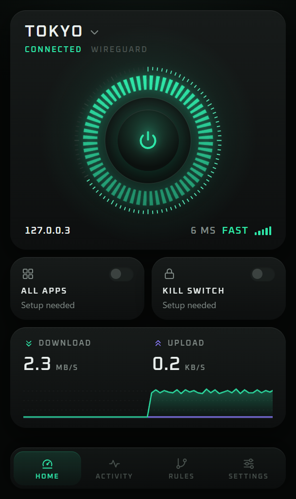
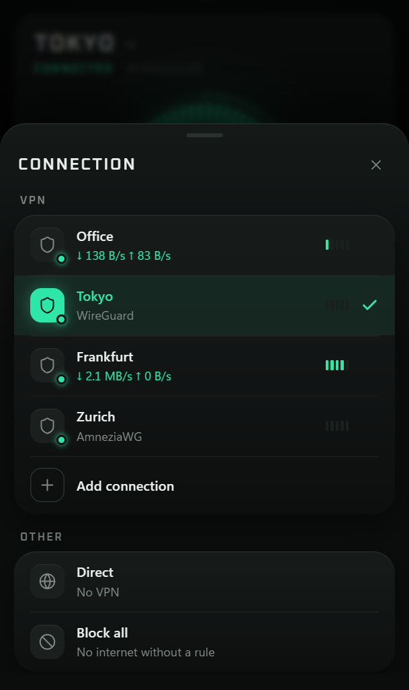
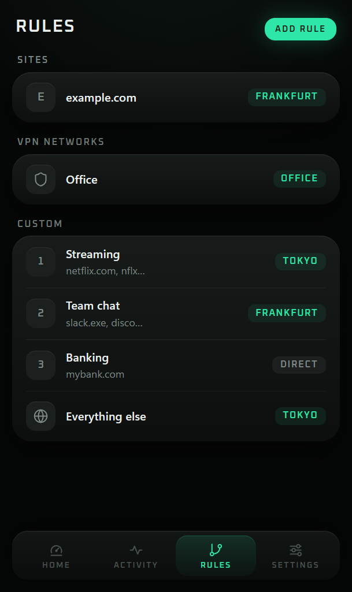
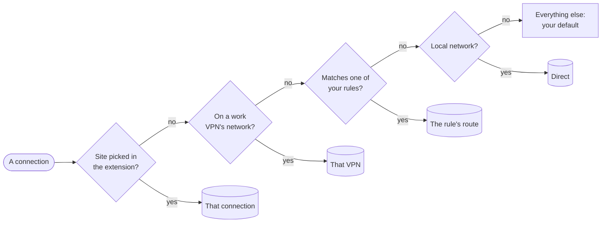

<div align="center">


# Moley

**Every VPN you have, working together.**

Import connections from any provider, run them side by side, and decide where each site, app and command goes.
Your work VPN for the intranet, a streaming server for Netflix, your own connection for everything else, all at once and with no reconnecting.

[](#install)
[](#install)
[](#the-browser-extension)
[](LICENSE)

[Install](#install) · [How it works](#how-it-works) · [Command line](#command-line) · [Build from source](#build-from-source) · [Design](docs/design.md)

<br>

<table>
  <tr>
    <td></td>
    <td></td>
    <td></td>
  </tr>
  <tr>
    <td align="center"><sub><b>One button.</b> Where you are, how fast, what's moving.</sub></td>
    <td align="center"><sub><b>Every connection, side by side.</b> Switch in a click.</sub></td>
    <td align="center"><sub><b>Rules in plain order.</b> The first match wins.</sub></td>
  </tr>
</table>

</div>

---

## Why Moley

Most VPN apps give you one switch: everything through one server, or nothing. Real life is messier. The company VPN has to reach the intranet, a show only streams in another country, a game wants the lowest ping, and your bank wants your real address.

Moley connects all of them at the same time and routes every connection on its own. You never pick a VPN again; you say what should go where, once.

- **One app for every provider.** OpenVPN, WireGuard, AmneziaWG, Shadowsocks, VLESS (with Reality), VMess, Trojan, Hysteria2, TUIC, SOCKS and HTTP. Drop in a `.ovpn` or `.conf` file, or paste a share link.
- **Many tunnels at once.** Every connection runs side by side in one lightweight engine. Switching where a site goes is instant and never drops your other tunnels.
- **Rules that read like sentences.** `netflix.com` through Tokyo. `slack.exe` through the office. `10.20.0.0/16` direct. The first rule that matches wins.
- **Per-site control in the browser.** Click the extension on any site and send it through any connection, or block it. No admin rights needed.
- **Work VPNs that just work.** Moley reads what your company's OpenVPN server pushes (its networks, DNS and domains) and routes only those through it. The rest of your traffic stays yours.
- **Fails closed, not open.** If a site is meant to go through a VPN that's down, it fails instead of quietly leaking out on your real connection. An optional kill switch blocks anything that would leave outside Moley.
- **Scriptable to the core.** A complete command line with JSON output, stable exit codes and no prompts, built for scripts and AI agents alike.

## Install

### Windows 10 and 11

1. Download `Moley-Setup-<version>.exe` from [Releases](https://github.com/NooberCong/moley/releases) and run it.
2. Moley opens in your system tray and starts with Windows. Click the icon to open it.
3. Add a connection: **Connection → Add connection**, then drop in a config file or paste a link.

The installer sets up the background service (for routing every app and the kill switch), the tray app, the browser extension's files and `moley` on your `PATH`. Updates are signed and install themselves.

### Linux

| Package | What you get |
|---|---|
| `.deb` / `.rpm` | The `moley` systemd service, the tray app and the CLI. Whoever installs with `sudo` joins the `moley` group that may control it. |
| AppImage | The tray app with a per-user engine: browser and command routing, no root. Routing every app needs a package. |

### The browser extension

Works in Chrome, Edge, Brave and Chromium.

1. Open `chrome://extensions` and turn on **Developer mode**.
2. Click **Load unpacked** and pick `C:\Program Files\Moley\extension` (Windows) or `/usr/share/moley/extension` on Linux.
3. Pin Moley to your toolbar.

## How it works

Every connection, from a browser tab, an app or a terminal, is checked against your routes from top to bottom. The first match decides where it goes.



| Route | You set it | Example |
|---|---|---|
| **Site picks** | One click in the browser extension | `crunchyroll.com` → Tokyo |
| **VPN networks** | Automatically, from what a work VPN pushes | `wiki.corp.example` → Office |
| **Rules** | The Rules tab, or `moley rules add` | `slack.exe`, `discord.exe` → Frankfurt |
| **Local network** | Always on | printers, NAS, router |
| **Everything else** | The power button | Direct, a VPN, or blocked |

**Connected** and **Disconnected** only change that last line. Your rules, site picks and work networks keep working either way, so turning the VPN off for a moment never cuts you off from the intranet.

### Two ways to route

- **Browser only** (default, no admin rights). The extension sends the browser through Moley; everything else on your computer is untouched.
- **All apps.** While you're connected, every app on the computer follows your rules, matched by name, so even apps that look up their own addresses route correctly. Disconnected, Moley's network adapter goes away and only the browser is routed, unless the kill switch is on or something holds it up. Turn it on in **Settings**.
  - **Holds.** A script or AI agent that needs a work network from a program like `psql` or `ssh` can hold the adapter up for a while (`moley holds put <name> --for 30m`) without connecting, so where everything else goes doesn't change. Each hold lapses on its own, and holds from different agents never undo each other. The tray names whoever holds it and can release a hold, and **All apps** on Home reads *Held on*.

### Kill switch

| Setting | What it does |
|---|---|
| **Off** | Nothing is blocked. |
| **On** | While Moley runs, nothing can leave outside it. |
| **Always** | Also while Moley is stopped, and from the moment the computer starts. |

Your local network stays reachable in every setting. Built on the Windows Filtering Platform and nftables on Linux.

## The app

| | |
|---|---|
| **Home** | Your connection at a glance: where everything goes, your public address, latency and live traffic. One button to connect or disconnect. |
| **Activity** | Every connection as it happens, with the rule and route it actually took. |
| **Rules** | Your routes in order. Add, edit, rename and reorder them. |
| **Settings** | All apps, kill switch, launch at startup and updates. |

Name your connections whatever you like (`Office`, `Tokyo`, `Home`); the app, the tray menu, notifications and the extension all use the name.

## Command line

Everything the app can do, `moley` can do, and a little more.

```sh
moley import work.ovpn --id office            # an encrypted key? add --key-password-stdin
moley import 'vless://…#tokyo'
moley wait --connected office

moley rules add stream --exit tokyo --domain-suffix netflix.com,nflxvideo.net
moley quick crunchyroll.com tokyo             # one site, instantly
moley default tokyo                           # everything else

moley probe https://wiki.corp.example         # which rule, route and DNS a request really uses
moley probe tcp://db.corp.example:5432        # the same for a database or SSH port
moley holds put my-agent --for 30m            # every app follows the rules for a while, default untouched
moley exec --exit tokyo -- curl -s https://ifconfig.co
moley conns --host netflix.com                # live connections and where they went

moley mode --tun on --kill-switch on          # every app, nothing leaks
moley events --json                           # status and traffic as they change (NDJSON)
moley history                                 # who changed what, and when
moley profiles update office --name Office    # rename; --auto-rule on|off
```

Built for automation:

- Every command takes `--json` and never prompts.
- Exit codes are stable: `0` ok, `1` error, `2` usage or confirmation needed, `3` Moley isn't running, `4` a check failed.
- `moley help --json` describes every command and every RPC method.

## Privacy and security

- **Nothing phones home.** No accounts, no telemetry, no analytics. On its own, Moley only checks for updates, tests your connections (latency and public address, shown on Home), and downloads the shared site lists your rules name, if any.
- **Secrets are sealed at rest** with the operating system's own protection (DPAPI on Windows), and they're redacted in exports unless you ask.
- **Local-only control.** The app, the extension and the CLI talk to the engine over a named pipe or Unix socket that web pages and other users can't reach. Every change is recorded with who made it.
- **Signed updates.** The app only installs updates signed with the release key.

## Build from source

You need Go (the toolchain pins itself through `go.mod`) and Node.js.

```sh
make build         # bin/moley: the engine and CLI
make ui            # bin/moley-ui: the tray app (Linux: GTK 4 and WebKitGTK 6 dev packages)
make extension     # extension/dist, ready to load unpacked
make test          # vet and tests against real VPN servers on loopback
make test-linux    # system mode and the kill switch in a systemd container (Docker)
make dist-windows  # dist/windows: the binaries and the installer (Docker)
make dist-linux    # dist/linux: .deb, .rpm and AppImage (Docker)
```

Without `make`:

```sh
GOFLAGS=-tags=with_gvisor,with_quic,with_wireguard,with_openvpn,with_utls go build ./cmd/moley
```

On Windows, `test/windows/system.ps1` checks system mode and the kill switch from an elevated PowerShell. Releases are signed with `cmd/moley-release`; build the tray app with `MOLEY_UPDATE_URL` and `MOLEY_UPDATE_KEY` set for it to update itself.

<details>
<summary><b>Project layout</b></summary>

```
cmd/moley/            the one binary: engine, CLI, browser native host
cmd/moley-ui/         tray app (Wails v3; its own module, a thin RPC client)
cmd/moley-release/    release keys and signed update manifests
internal/model/       config types, validation, sealed store
internal/importer/    .ovpn, .conf and share links → connections
internal/compile/     config → sing-box options and rule-sets (pure)
internal/engine/      sing-box lifecycle, hot reload, probes, connections, work VPN routes
internal/awg/         AmneziaWG (amneziawg-go on a userspace network stack)
internal/daemon/      RPC methods, audit log
internal/rpc/         length-prefixed JSON (the same framing as native messaging)
internal/cli/         commands, native host relay
internal/platform/    pipes and sockets, service, kill switch (WFP, nftables), secret sealing
internal/teststack/   real OpenVPN, WireGuard, AmneziaWG and Shadowsocks servers on loopback
extension/            Chromium MV3 extension (TypeScript)
packaging/            NSIS installer, .deb and .rpm (nfpm), AppImage
test/                 end-to-end tests: Linux in Docker, Windows elevated
```

How it all fits together, and why: [docs/design.md](docs/design.md).

</details>

## FAQ

<details>
<summary><b>Does Moley replace my VPN provider?</b></summary>

No. Moley is the app; your providers are the servers. Bring the configs you already have (from Proton VPN, Mullvad, your company, your own WireGuard server, a proxy subscription) and Moley runs them together.
</details>

<details>
<summary><b>My company VPN normally takes over all my traffic. What happens in Moley?</b></summary>

Moley ignores the server's request to take over the whole internet and routes only the networks and domains it pushes. If you want everything through it, choose it as your connection on Home.
</details>

<details>
<summary><b>Do I need administrator rights?</b></summary>

Only to route every app or use the kill switch. Browser routing and `moley exec` work for any user.
</details>

<details>
<summary><b>What happens when I restart my computer?</b></summary>

Moley starts with your computer and picks up where you left it: connected if you were connected, disconnected if not. Your work networks are routed either way.
</details>

<details>
<summary><b>What about macOS and phones?</b></summary>

Not yet. The engine is portable and macOS is planned on the same code.
</details>

## License

Moley is free software under the [GNU General Public License v3.0](LICENSE).

Moley's engine is built on [sing-box](https://github.com/SagerNet/sing-box) (GPL-3.0-or-later). Moley is an independent project and is not affiliated with or endorsed by sing-box.
